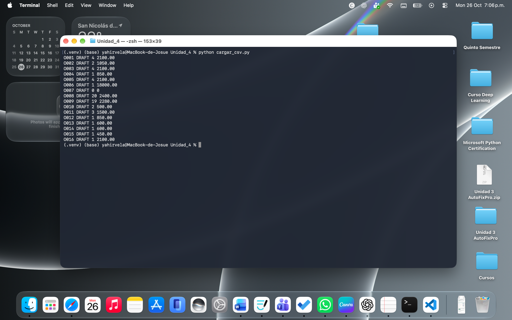
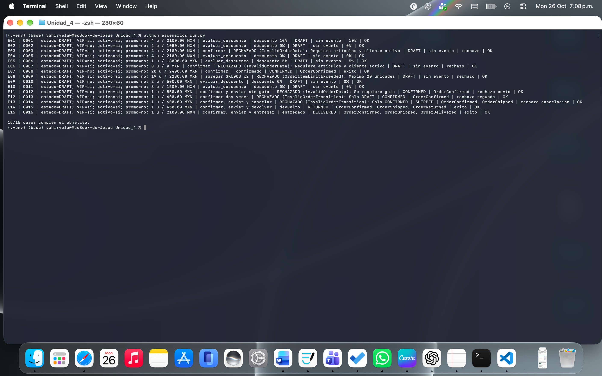
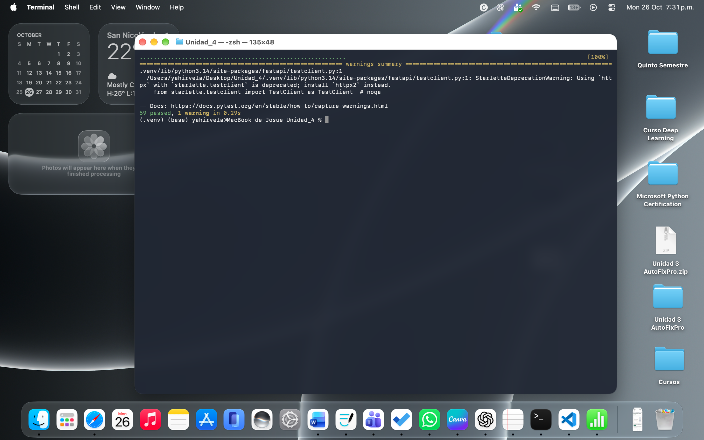
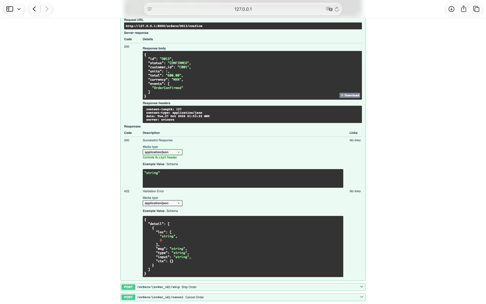
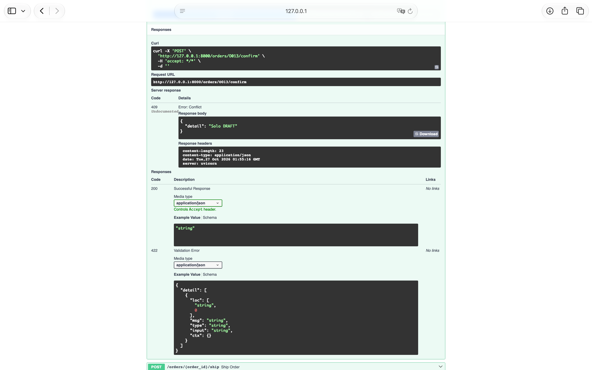
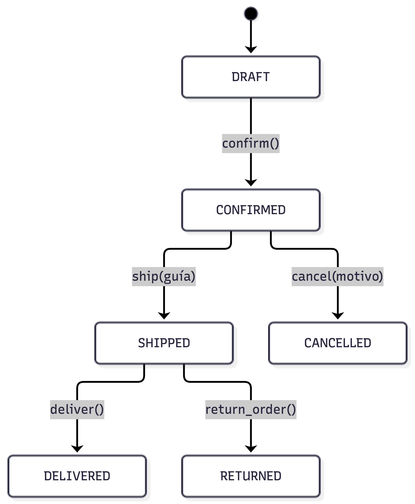

# TechStore U4 — Núcleo de negocio (Actividad 4, CLN · FIME UANL)

Pedidos de una tienda ficticia: entidades y Value Objects con invariantes,
Specification Pattern, máquina de estados con Domain Events y API REST con
FastAPI. Todo en memoria (sin base de datos).

## Instalación (macOS / Linux)

```bash
python3 -m venv .venv
source .venv/bin/activate
python -m pip install -r requirements.txt
```

Requiere Python 3.11 o superior.

## Ejecución

```bash
python cargar_csv.py                 # carga los 16 pedidos (todos DRAFT)
python escenarios_run.py             # ejecuta E01-E15 y genera bitacora_escenarios.csv
python -m pytest -q                  # pruebas automáticas
python -m uvicorn app.api:app --reload
```

Documentación interactiva: http://127.0.0.1:8000/docs
Contrato OpenAPI: http://127.0.0.1:8000/openapi.json

## Estructura

```
app/domain.py          Money, Customer, OrderItem, Order, OrderStatus, DomainEvent, excepciones
app/specifications.py  Specification, AND/OR/NOT, reglas simples y de descuento
app/api.py             API REST (controladores delgados)
tests/                 test_domain.py y test_api.py (pytest)
datos/                 CSV de clientes, productos, pedidos, detalle y escenarios
cargar_csv.py          cargador de fixtures
escenarios_run.py      ejecuta los 15 escenarios y genera la bitácora
docs/estados.md        diagrama de estados y explicación de eventos
```

## Reglas de negocio

- Money usa `Decimal`, no admite importes negativos ni monedas distintas.
- Máximo 20 **unidades** por pedido (no 20 renglones). Solo MXN.
- Descuento 10 %: cliente VIP, total > 500, al menos 4 unidades y sin promoción.
- Descuento 5 %: total > 5000 y sin promoción. Si ambas aplican, gana el 10 %.
- Confirmar: solo desde DRAFT, con artículos y cliente activo.
- Enviar: solo desde CONFIRMED y con guía. Cancelar: solo desde CONFIRMED y con motivo.
- Entregar y devolver: solo desde SHIPPED.

## Endpoints

| Método | Ruta | Respuestas |
|---|---|---|
| GET | /orders/{id} | 200, 404 |
| POST | /orders/{id}/confirm | 200, 404, 409, 422 |
| POST | /orders/{id}/ship  (`{"tracking_number": "..."}`) | 200, 404, 409, 422 |
| POST | /orders/{id}/cancel (`{"reason": "..."}`) | 200, 404, 409, 422 |

404 = el pedido no existe · 409 = transición no permitida · 422 = datos inválidos
o regla violada. El estado vive en memoria: reinicia el servidor para repetir casos.

## Evidencias

### Carga de los 16 pedidos


### Escenarios E01–E15


### Pruebas pytest


### Swagger: operación exitosa (200)


### Swagger: operación rechazada (409)


### Diagrama de estados
