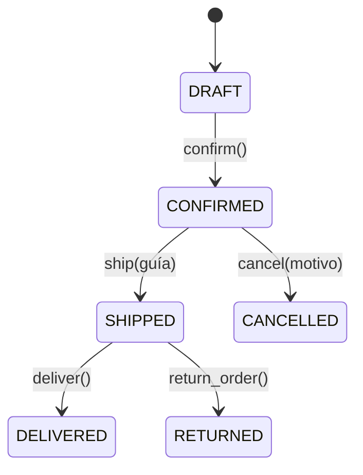

# Máquina de estados de Order y Domain Events



Versión en texto:

```
DRAFT --confirm--> CONFIRMED --ship--> SHIPPED --deliver--> DELIVERED
                       |                  |
                     cancel             return
                       |                  |
                   CANCELLED           RETURNED
```

| Transición | Precondiciones | Evento publicado |
|---|---|---|
| confirm() | estado DRAFT, al menos un artículo, cliente activo | OrderConfirmed |
| ship(guía) | estado CONFIRMED, guía no vacía | OrderShipped |
| cancel(motivo) | estado CONFIRMED, motivo no vacío | OrderCancelled |
| deliver() | estado SHIPPED | OrderDelivered |
| return_order() | estado SHIPPED | OrderReturned |

## Por qué el evento se registra al final

Cada método valida primero, cambia `status` después y registra el evento en la
última línea. Si una validación falla, la excepción se lanza antes y el evento
nunca se crea: una operación fallida no anuncia un hecho que no ocurrió.

Los eventos son inmutables (`frozen=True`), llevan `name`, `order_id` y
`occurred_at`, y se acumulan en `Order.events`.
